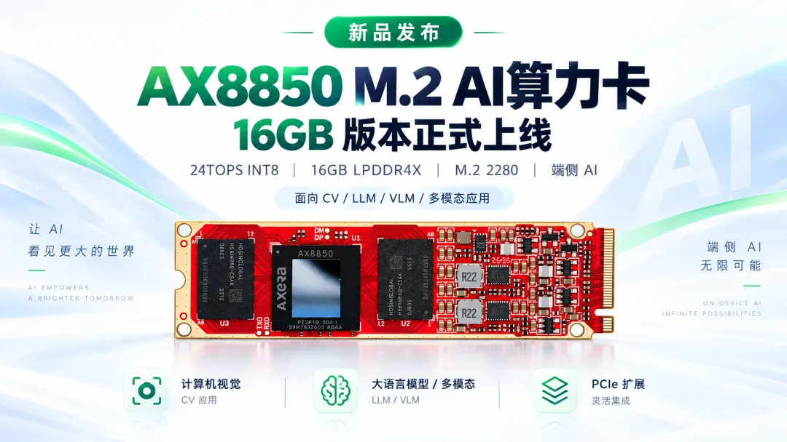

# 百问网

## 公司简介

| 字段 | 内容 |
| --- | --- |
| 官网 | [百问网](https://www.100ask.net/) |
| 简介 | 百问网（韦东山团队）提供基于 AX8850 的 M.2 AI 算力卡，以及配套的 EdgeAccel 硬件安装、AXCL 环境配置和模型部署教程。 |

## AX8850 M.2 AI 算力卡（8GB / 16GB）

该产品通过 M.2 为现有 ARM 或 x86 主机扩展 AI 算力。主机负责系统、存储、外设和业务逻辑，算力卡通过 AXCL 执行模型推理与媒体处理任务。



### 产品亮点与规格

| 字段 | 内容 |
| --- | --- |
| 芯片 | AX8850 |
| AI 算力 | 24 TOPS@INT8 |
| DDR | 8GB / 16GB 两种版本；16GB 版本采用 LPDDR4X |
| 主机接口 | M.2 M-Key，PCIe 2.0 ×2；实际链路速率和宽度以主机检查结果为准 |
| 尺寸 | M.2 2280，名义尺寸 22mm × 80mm；安装时需另留散热空间 |
| 视频能力 | 支持 H.264/H.265 编解码，具体处理能力以 AXCL 接口及项目实测为准 |
| 开发生态 | AXCL，支持 C / Python；EdgeAccel 提供模型部署教程 |
| 产品形态 | M.2 算力卡，需搭配兼容主机使用 |
| 供电 | 通过 M.2 接口提供 3.3V 电源 |
| 功耗 | 官方硬件文档标注实测约 8W，实际功耗随模型负载与运行配置变化 |
| 散热 | 使用配套散热器与风扇，运行模型期间保持风扇工作 |

```{note}
8GB / 16GB 指整卡内存容量，卡端系统、模型和媒体缓冲共享这些资源，实际可用的 CMM 内存由固件划分决定。部署时应使用与容量匹配的 PAC 固件，并核对目标模型对应版本的实测结果；16GB 上运行成功不代表已通过 8GB 验证。
```

### 适用场景

- 为 ARM、x86 Linux 主机增加本地 AI 推理能力。
- 目标检测、OCR、图像分割和多路视频分析。
- LLM / VLM、本地 AI 助手、语音交互和多模态应用。
- 机器人视觉感知、工业视觉及边缘计算项目验证。

### 上手注意事项

1. 主机需提供支持 PCIe 的 M.2 M-Key 插槽，或使用适配的 PCIe 转接板，并确认供电及散热空间满足要求。
2. 关机并断电后安装、固定算力卡，再按官方教程安装适用于主机系统与架构的 AXCL 驱动和运行库。
3. 本卡不能作为 NVMe 硬盘使用，也不能通过普通 USB 转 NVMe 硬盘盒接入；摄像头、显示器和网络设备应连接主机。
4. 在 Linux 主机上使用 `lspci -nn` 确认 PCIe 设备可枚举，再使用 `axcl-smi` 检查设备、温度和内存状态，最后按教程运行已适配的模型。
5. 评估模型时记录主机、卡容量、固件、模型、量化方式和上下文等配置；更大内存主要增加模型运行空间，不代表推理速度按容量同比提升。

### 资源与购买链接

- [官方产品介绍](https://www.100ask.net/hardware/100ask_ax8850-m2)
- [EdgeAccel 使用文档](https://edgeaccel.100ask.net/)
- [硬件介绍、接口与供电散热说明](https://edgeaccel.100ask.net/docs/getting-started/hardware/)
- [AXCL 文档](https://axcl-docs.readthedocs.io/zh-cn/latest/)
- [官方淘宝购买链接](https://e.tb.cn/h.jQACcK1jx5qDSTJ?tk=HQPc6W6j8kI)
